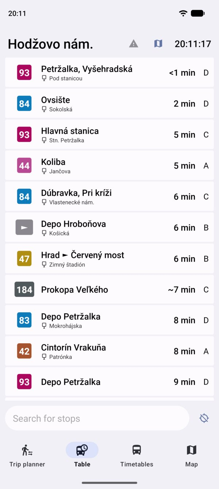
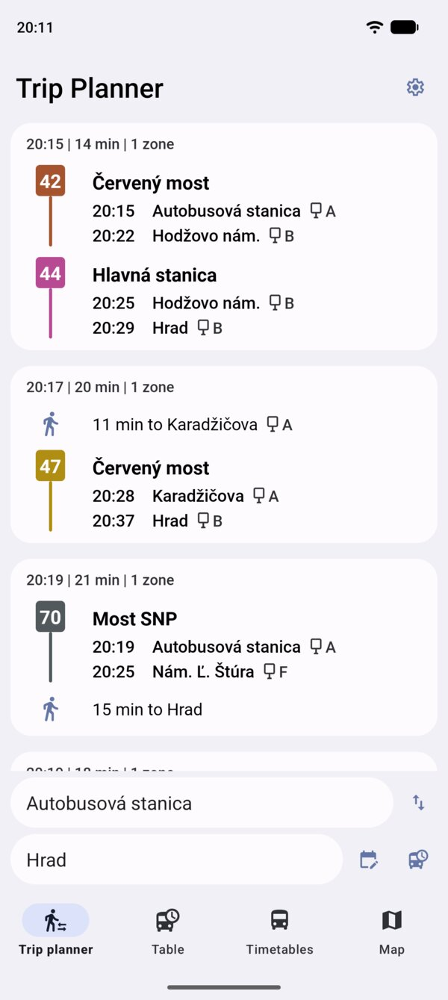
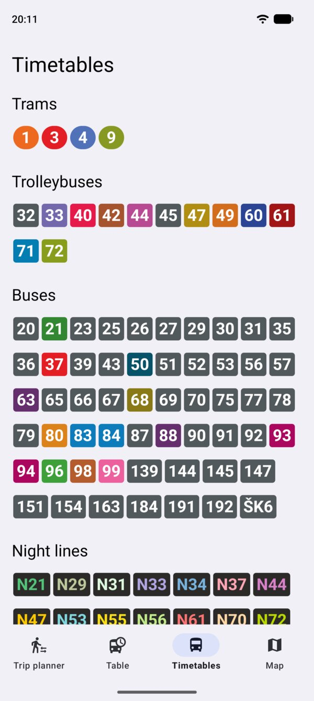

   <picture>
     <source width="200" media="(prefers-color-scheme: dark)" srcset="https://github.com/user-attachments/assets/084590ee-b52f-4168-8b69-42c3870a8601" />
     
   </picture>
    
    
  <picture>
    <source
      height="31px"
      media="(prefers-color-scheme: dark)"
      srcset="https://github.com/magicsk/Transi-swift/assets/49265057/d02bd6bb-1d11-41f0-9be5-ab03c723dc9d"
    >
    
  </picture>

#

Native android app with a list of virtual tables,
trip planner and timetables for MHD in Bratislava.

<picture>
     <source media="(prefers-color-scheme: dark)" srcset=".github/readme/table-dark.jpg" />
     
</picture>
<picture>
     <source media="(prefers-color-scheme: dark)" srcset=".github/readme/planner-dark.jpg" />
     
</picture>
<picture>
     <source media="(prefers-color-scheme: dark)" srcset=".github/readme/timetables-dark.jpg" />
     
</picture>

## Features

On the virtual table you can see actual departures in real time
with delays, informations about vehicle and more. By long pressing on a specific
connection you can create a notification which will update in real
time. With the same gesture you can create a notification of the
searched trip from the trip planner. There are also timetables.
Everything requires internet connection but database of stops is
cached to save data.

### More screenshots and info on [transi.eu](https://transi.eu)

## Download

Transi is for now only available for download in
[GitHub releases](https://github.com/magicsk/Transi/releases). 
